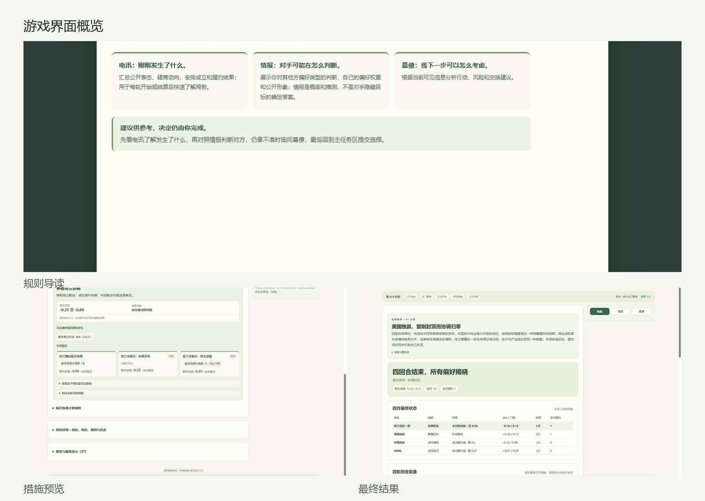
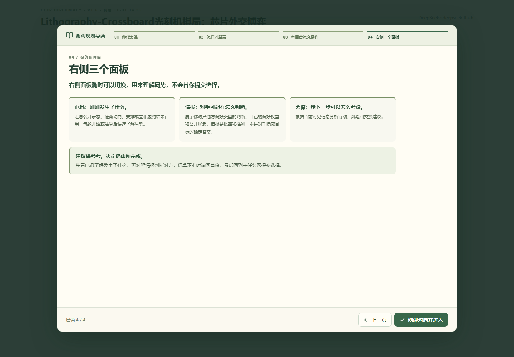
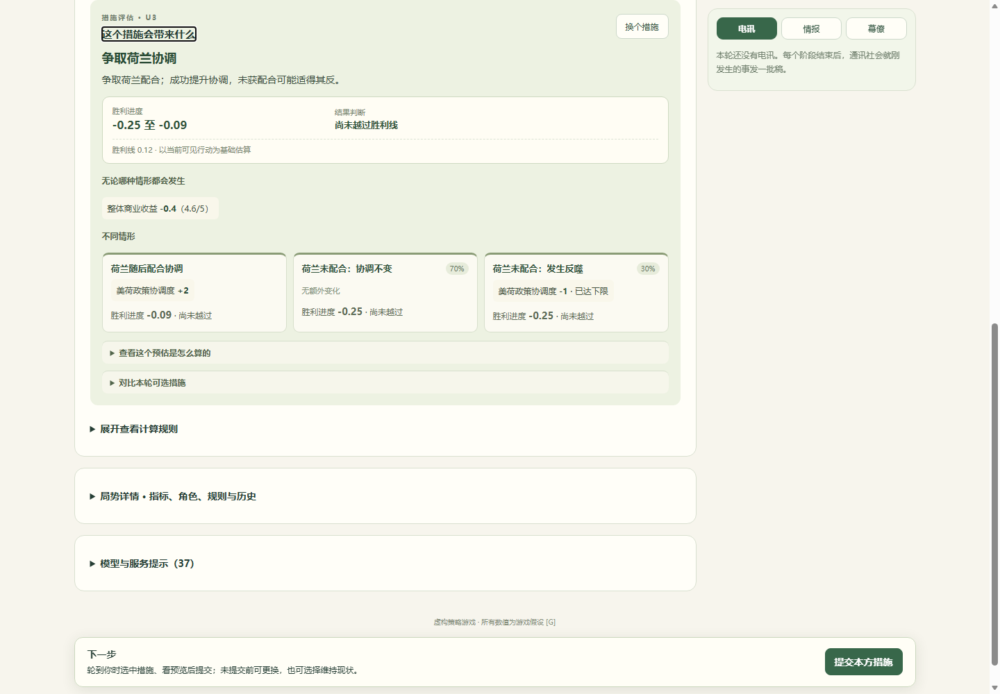
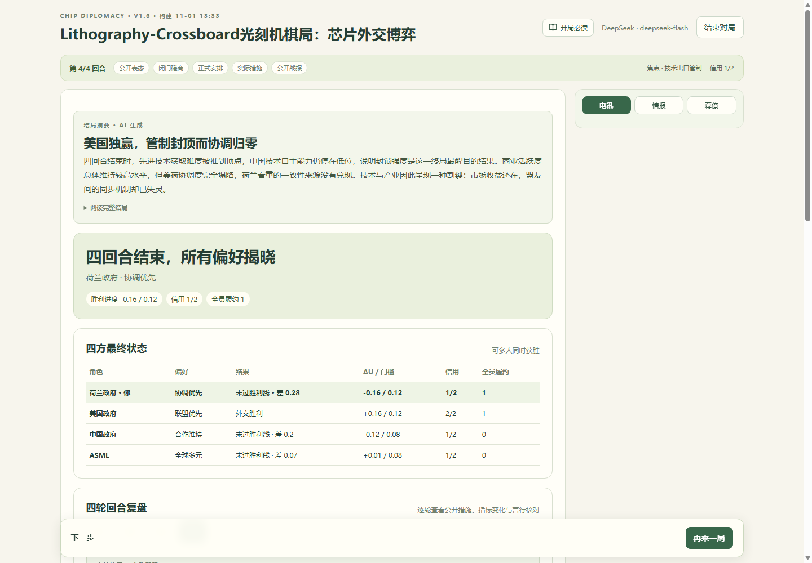

# 芯片外交：Lithography-Crossboard

**四方、四回合、不完全信息的芯片外交策略游戏**

<p>
  
  
  
  
</p>

[在线体验](https://chip-diplomacy.app.workbuddy.host/?sharecode=3UW6RQU7HA) ·
[游戏规则](docs/game-rules-v16.md) ·
[运行演示说明](docs/RUN-DEMO.md) ·
[Word 版说明](docs/运行演示说明.docx) ·
[接口约定](docs/game-v16-contracts.md)



## 作品简介

玩家扮演美国、中国、荷兰或 ASML，在四回合内通过公开表态、闭门磋商、正式安排和实际措施影响半导体产业局势。每方会秘密抽取一个个人目标。个人目标影响胜利进度的计算方式，但不会限制玩家可采取的措施。

游戏采用序贯行动结构。实际行动按美国、荷兰、中国、ASML 的顺序逐个落地，后手能够观察先手已经公开的措施再作决策。ASML 的行动默认不公开，只有灰色交易被查获时进入公开结算。

## 核心玩法

每个回合包含五个阶段：

| 阶段 | 玩家操作 |
| --- | --- |
| 公开表态 | 就一个议题发表合作或强硬立场，也可以保持沉默 |
| 闭门磋商 | 发送公开或私聊消息，起草包含多方行动承诺的正式安排 |
| 安排确认 | 发起方已经确认，受邀方接受或拒绝；任一受邀方拒绝则整份安排作废 |
| 实际行动 | 按美国、荷兰、中国、ASML 的顺序选择合法措施并提交 |
| 公开战报 | 查看指标变化、信用、履约和胜利进度，进入下一回合 |

第四回合结束后，玩家可以查看四方最终状态、逐轮战报、单轮完整博弈树、四轮行动路径环和 AI 生成的赛后结局。

## 功能亮点

- **序贯行动与不完全信息**：四方按固定顺序决策，未公开行动和私人目标不会泄露给无权查看的角色。
- **正式承诺与信用**：履约提高信用，违约会降低信用；信用不足会取消实质胜利资格。
- **AI 对手与顾问**：DeepSeek 参与表态、磋商、签约、行动建议和赛后叙事，结构校验失败时使用确定性规则回退。
- **五阶段规则导读**：选择角色后、创建对局前展示角色介绍、胜利条件、阶段操作和辅助面板说明。
- **两层措施预览**：首层显示确定变化、分支结果和胜利进度范围；计算依据与措施对比默认折叠。
- **完整复盘**：结局页包含逐轮战报、单轮博弈树和四轮行动路径环。
- **响应式界面**：桌面和手机尺寸均可使用，关键指标和操作按钮保持可读。

## 界面截图

<table>
  <tr>
    <td width="50%">
      
      <br>
      <sub>角色选择后的四页规则导读</sub>
    </td>
    <td width="50%">
      
      <br>
      <sub>两层措施预览与分支结果</sub>
    </td>
  </tr>
  <tr>
    <td colspan="2">
      
      <br>
      <sub>四方最终状态、AI 结局与完整复盘入口</sub>
    </td>
  </tr>
</table>

## 在线体验

https://chip-diplomacy.app.workbuddy.host/?sharecode=3UW6RQU7HA

在线版本已经配置模型服务，可体验完整四回合对局。

## 本地运行

### 环境要求

- Node.js 22 或更高版本
- Chrome、Edge、Firefox 或 Safari 的近期版本
- 完整 AI 对局所需的 `DEEPSEEK_API_KEY`

### Windows

```powershell
npm ci
Copy-Item .env.example .env
# 编辑 .env，填写 DEEPSEEK_API_KEY
npm start
```

### macOS / Linux

```bash
npm ci
cp .env.example .env
# 编辑 .env，填写 DEEPSEEK_API_KEY
npm start
```

`npm start` 会构建前端并启动同端口后端。浏览器打开：

```text
http://127.0.0.1:5001/
```

密钥只放在服务端 `.env` 中，不要使用 `VITE_*` 变量，也不要提交真实密钥。

## 模型与规则边界

所有指标、概率、行动效果和胜利门槛均为虚构游戏假设 `[G]`，不代表现实政策预测。

模型只负责在服务端提供的合法空间中作选择或生成文本。指标结算由确定性规则引擎完成，模型不可修改规则、系数或胜负条件。模型不可用时，游戏使用明确标注的确定性策略兜底，不伪造模型回复。

## 验证状态

| 检查项 | 结果 |
| --- | --- |
| TypeScript 类型检查 | 通过 |
| Vitest 自动化测试 | 312 项通过 |
| Vite 生产构建 | 通过 |
| 在线正式链接 | HTTP 200 |
| 在线 DeepSeek | enabled |

本地验证命令：

```bash
npm run typecheck
npm run test
npm run build
```

## 项目结构

```text
src/game-v1/       四回合外交博弈前端
server/v1/         规则引擎、AI 投影与接口
public/            开局图像与新闻配图
docs/              规则、接口、部署和运行说明
tests/             引擎、接口与界面测试
ops/               发布与校准工具
```

## 主要文档

- [游戏规则 V1.6](docs/game-rules-v16.md)
- [运行与演示说明](docs/RUN-DEMO.md)
- [Word 版运行演示说明](docs/运行演示说明.docx)
- [V1.6 接口约定](docs/game-v16-contracts.md)
- [外交博弈接口约定](docs/diplomacy-contracts.md)
- [部署与回滚](docs/diplomacy-deployment.md)
- [开发验收记录](docs/diplomacy-progress.md)

## 许可证

本项目使用 GNU Affero General Public License v3.0。第三方来源与许可信息见 [THIRD_PARTY_NOTICES.md](THIRD_PARTY_NOTICES.md)。
