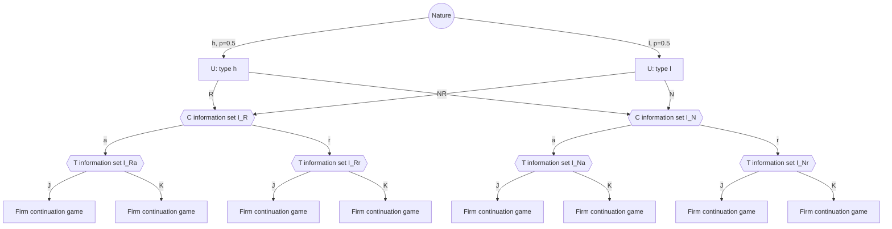

# 五智能体不完全信息动态博弈：PBE 数值示例

## 1. 示例目的

本示例演示两件事：

1. 五个智能体如何写进同一棵扩展式博弈树；
2. 政府—企业、企业—企业等局部结构如何作为延续博弈嵌入全局树，而不是另建五套互不相连的模型。

数字均为随机设计的教学数字，不代表真实半导体产业参数。

## 2. 五个智能体与行动

收益向量顺序统一为：

\[
(u_U,u_C,u_T,u_A,u_B)
\]

| 符号 | 智能体 | 行动 |
|---|---|---|
| \(U\) | 美国政府 | 限制 \(R\)，不限制 \(N\) |
| \(C\) | 中国政府 | 反制 \(r\)，接受 \(a\) |
| \(T\) | 第三方政府与企业集合体 | 加入美国联盟 \(J\)，保持对冲 \(K\) |
| \(A\) | 美国企业集合体 | 扩张 \(E\)，观望 \(W\) |
| \(B\) | 中国企业集合体 | 扩张 \(E\)，观望 \(W\) |

只有美国政府具有私人类型：

- \(h\)：高安全偏好、高限制意愿；
- \(\ell\)：低安全偏好、低限制意愿；
- 共同先验为 \(P(h)=P(\ell)=0.5\)。

中国政府不知道美国政府的真实类型，只能观察其选择 \(R\) 或 \(N\)。

## 3. 全局扩展式博弈

完整有限博弈可写为：

\[
\Gamma=
\langle
N,\Theta,p,H,Z,A,\{I_i\},\{\beta_i\},\{\mu_i\},u
\rangle
\]

其中：

- \(N=\{U,C,T,A,B\}\)；
- \(\Theta=\{h,\ell\}\)；
- \(p(h)=p(\ell)=0.5\)；
- \(H\) 是非终止历史；
- \(Z\) 是终止历史；
- \(I_i\) 是智能体 \(i\) 的信息集；
- \(\beta_i(a\mid I_i)\) 是行为策略；
- \(\mu_i(\theta\mid I_i)\) 是信息集上的信念；
- \(u_i(z,\theta)\) 是类型和终止历史对应的收益。

### 3.1 行动时序

1. 自然选择美国政府类型；
2. 美国政府观察自己的类型，选择 \(R\) 或 \(N\)；
3. 中国政府观察 \(R\) 或 \(N\)，但不知道类型，选择 \(a\) 或 \(r\)；
4. 第三方主体观察前两步，但不知道类型，选择 \(J\) 或 \(K\)；
5. 美国企业和中国企业同时选择 \(E\) 或 \(W\)，完成局部市场延续博弈；
6. 博弈结束并结算收益。

完整展开时，叶节点数量为：

\[
2\text{ 个类型}
\times 2\text{ 个美国政府行动}
\times 2\text{ 个中国政府行动}
\times 2\text{ 个第三方行动}
\times 2\text{ 个美国企业行动}
\times 2\text{ 个中国企业行动}
=64.
\]

因此下文的全局树是压缩表示：每个企业延续博弈 \(F\) 在完整树中展开为 4 个终止节点。

### 3.2 压缩博弈树



图中的 \(I_R\) 实际代表两个不同的决策节点：

\[
I_R=\{h\text{-}R,\ell\text{-}R\}
\]

这两个节点属于同一信息集，因为中国政府不知道是 \(h\) 还是 \(\ell\)。同理：

\[
I_N=\{h\text{-}N,\ell\text{-}N\}.
\]

第三方主体的信息集也是跨类型的：

\[
I_{Ra}=\{h\text{-}R\text{-}a,\ell\text{-}R\text{-}a\},
\quad
I_{Rr}=\{h\text{-}R\text{-}r,\ell\text{-}R\text{-}r\},
\]

\[
I_{Na}=\{h\text{-}N\text{-}a,\ell\text{-}N\text{-}a\},
\quad
I_{Nr}=\{h\text{-}N\text{-}r,\ell\text{-}N\text{-}r\}.
\]

### 3.3 等价的文字树

```text
Nature
├─ h (0.5)
│  └─ U
│     ├─ R ──→ C at I_R
│     │        ├─ a ──→ T at I_Ra ──→ J → F
│     │        │                     └ K → F
│     │        └─ r ──→ T at I_Rr ──→ J → F
│     │                              └ K → F
│     └─ N ──→ C at I_N
│              ├─ a ──→ T at I_Na ──→ J → F
│              │                     └ K → F
│              └─ r ──→ T at I_Nr ──→ J → F
│                                     └ K → F
└─ l (0.5)
   └─ U
      ├─ R ──→ C at I_R
      ├─ N ──→ C at I_N
      └─ ...
```

这里的 \(F\) 不是另一个独立模型，而是嵌入每个历史末端的局部市场延续博弈。

## 4. 企业局部延续博弈

给定任一历史，美国企业和中国企业同时选择 \(E\) 或 \(W\)。收益矩阵为：

|  | \(B:E\) | \(B:W\) |
|---|---:|---:|
| \(A:E\) | \((3,3)\) | \((5,1)\) |
| \(A:W\) | \((1,5)\) | \((2,2)\) |

对任一企业：

- 对方选择 \(E\) 时，选择 \(E\) 优于 \(W\)；
- 对方选择 \(W\) 时，选择 \(E\) 仍优于 \(W\)。

所以 \(E\) 是两家企业的严格占优策略，唯一纳什均衡为：

\[
(E,E).
\]

这个结果与历史无关，因此每个 \(F\) 的均衡延续收益是：

\[
(u_A,u_B)=(3,3).
\]

在本例中，美国政府把本国企业均衡利润计入自己的产业收益，中国企业也如此。因此 \(F\) 的均衡结果为：

\[
U\text{增加 }3,\quad C\text{增加 }3.
\]

### 4.1 同时行动在扩展式中的写法

如果按扩展式表示，而不是直接用收益矩阵，可以令美国企业先选择，但让中国企业在同一信息集内行动，从而表达“同时行动”：

```text
美国企业 A
├─ E ──→ 中国企业 B at I_F
│         ├─ E → (3,3)
│         └─ W → (5,1)
└─ W ──→ 中国企业 B at I_F
          ├─ E → (1,5)
          └─ W → (2,2)
```

其中：

\[
I_F=\{A\text{选择}E,\ A\text{选择}W\}.
\]

中国企业不知道美国企业已经选择了 \(E\) 还是 \(W\)，所以两个 \(B\) 决策节点属于同一信息集。这样写出的扩展式与上面的 2×2 同时行动矩阵等价。

## 5. 数值收益

### 5.1 美国政府收益

美国政府的阶段收益为：

\[
u_U
=
b_U(\theta,s)
+g_U(c)
+q_U(t)
+u_A.
\]

其中 \(s\in\{R,N\}\)，\(c\in\{a,r\}\)，\(t\in\{J,K\}\)。

| 类型与信号 | \(b_U\) |
|---|---:|
| \(h,R\) | 8 |
| \(h,N\) | 4 |
| \(\ell,R\) | 1 |
| \(\ell,N\) | 6 |

中国政府行动的影响：

\[
g_U(a)=0,\quad g_U(r)=-2.
\]

第三方行动的影响：

\[
q_U(J)=2,\quad q_U(K)=0.
\]

### 5.2 中国政府收益

中国政府收益为：

\[
u_C=b_C(\theta,s,c)+u_B.
\]

\(b_C\) 的数值为：

| 类型与信号 | \(c=a\) | \(c=r\) |
|---|---:|---:|
| \(h,R\) | 3 | 1 |
| \(h,N\) | 2 | 4 |
| \(\ell,R\) | 0 | 2 |
| \(\ell,N\) | 2 | 5 |

### 5.3 第三方主体收益

第三方主体不知道真实类型，但它行动时的收益取决于真实类型。其收益 \(u_T\) 为：

| 类型与历史 | \(t=J\) | \(t=K\) |
|---|---:|---:|
| \(h,R,a\) | 4 | 2 |
| \(h,R,r\) | 5 | 1 |
| \(h,N,a\) | 1 | 3 |
| \(h,N,r\) | 0 | 2 |
| \(\ell,R,a\) | 0 | 3 |
| \(\ell,R,r\) | -2 | 2 |
| \(\ell,N,a\) | 0 | 3 |
| \(\ell,N,r\) | 0 | 2 |

### 5.4 四类关键终止收益

收益向量顺序为 \((u_U,u_C,u_T,u_A,u_B)\)。

| 终止历史 | 收益向量 |
|---|---:|
| \(h,R,a,J,E,E\) | \((13,6,4,3,3)\) |
| \(h,N,r,K,E,E\) | \((5,7,2,3,3)\) |
| \(\ell,R,a,J,E,E\) | \((6,3,0,3,3)\) |
| \(\ell,N,r,K,E,E\) | \((7,8,2,3,3)\) |

例如：

\[
u_U(h,R,a,J)
=8+0+2+3=13,
\]

\[
u_C(h,R,a)
=3+3=6.
\]

## 6. 候选分离 PBE

### 6.1 行为策略

美国政府：

\[
\beta_U(R\mid h)=1,\qquad
\beta_U(N\mid \ell)=1.
\]

即高类型选择限制，低类型选择不限制。

中国政府：

\[
\beta_C(a\mid I_R)=1,\qquad
\beta_C(r\mid I_N)=1.
\]

即看到限制时接受，看到不限制时反制。

第三方主体：

\[
\beta_T(J\mid I_{Ra})
=
\beta_T(J\mid I_{Rr})
=1,
\]

\[
\beta_T(K\mid I_{Na})
=
\beta_T(K\mid I_{Nr})
=1.
\]

即看到限制就加入联盟，看到不限制就保持对冲。

两家企业：

\[
\beta_A(E)=1,\qquad \beta_B(E)=1.
\]

### 6.2 信念

在候选分离均衡中，只有高类型选择 \(R\)，只有低类型选择 \(N\)。由贝叶斯法则：

\[
\mu_U(h\mid I_R)=1,\qquad
\mu_U(h\mid I_N)=0.
\]

第三方主体使用同一信号推断：

\[
\mu_T(h\mid I_{Ra})
=
\mu_T(h\mid I_{Rr})
=1,
\]

\[
\mu_T(h\mid I_{Na})
=
\mu_T(h\mid I_{Nr})
=0.
\]

企业虽然在每个历史后行动，但其收益与类型无关，而且 \(E\) 严格占优，所以企业信念不影响行为策略。为保持信息集定义完整，也可以令其采用与政府信号相同的信念。

## 7. 逐信息集检验序贯理性

### 7.1 中国政府

在 \(I_R\) 上，信念为：

\[
\mu_C(h\mid I_R)=1.
\]

选择 \(a\) 的收益为：

\[
u_C(h,R,a)=3.
\]

选择 \(r\) 的收益为：

\[
u_C(h,R,r)=1.
\]

因为 \(3>1\)，所以：

\[
a\succ r.
\]

在 \(I_N\) 上，信念为：

\[
\mu_C(h\mid I_N)=0.
\]

选择 \(a\) 的收益为：

\[
u_C(\ell,N,a)=2.
\]

选择 \(r\) 的收益为：

\[
u_C(\ell,N,r)=5.
\]

因为 \(5>2\)，所以：

\[
r\succ a.
\]

因此中国政府的策略在每个信息集上都是最优反应。

### 7.2 第三方主体

在 \(I_{Ra}\) 上，信念为 \(h\)，所以：

\[
u_T(h,R,a,J)=4>u_T(h,R,a,K)=2.
\]

在 \(I_{Rr}\) 上，信念仍为 \(h\)，所以：

\[
u_T(h,R,r,J)=5>u_T(h,R,r,K)=1.
\]

在 \(I_{Na}\) 上，信念为 \(\ell\)，所以：

\[
u_T(\ell,N,a,K)=3>u_T(\ell,N,a,J)=0.
\]

在 \(I_{Nr}\) 上，信念仍为 \(\ell\)，所以：

\[
u_T(\ell,N,r,K)=2>u_T(\ell,N,r,J)=0.
\]

因此第三方主体的策略满足序贯理性。

### 7.3 企业

无论对方选择什么，选择 \(E\) 的收益都严格大于选择 \(W\)：

\[
3>1,\qquad 5>2.
\]

因此两家企业在所有信息集上的最优反应都是 \(E\)。

### 7.4 美国政府高类型

若选择 \(R\)，后续策略为 \(a,J,E,E\)：

\[
u_U(h,R,a,J)=13.
\]

若偏离到 \(N\)，中国政府根据 \(I_N\) 的信念选择 \(r\)，第三方选择 \(K\)：

\[
u_U(h,N,r,K)=5.
\]

因为：

\[
13>5,
\]

高类型不会偏离。

### 7.5 美国政府低类型

若选择 \(N\)，后续策略为 \(r,K,E,E\)：

\[
u_U(\ell,N,r,K)=7.
\]

若偏离到 \(R\)，中国政府根据 \(I_R\) 的信念选择 \(a\)，第三方选择 \(J\)：

\[
u_U(\ell,R,a,J)=6.
\]

因为：

\[
7>6,
\]

低类型不会偏离。

## 8. 结论

上述策略和信念构成一个分离完美贝叶斯均衡：

| 智能体 | 均衡策略 |
|---|---|
| 美国政府 | 高类型 \(R\)，低类型 \(N\) |
| 中国政府 | \(R\) 后 \(a\)，\(N\) 后 \(r\) |
| 第三方主体 | \(R\) 后 \(J\)，\(N\) 后 \(K\) |
| 美国企业 | \(E\) |
| 中国企业 | \(E\) |

均衡路径有两条：

\[
h\to R\to a\to J\to(E,E),
\]

\[
\ell\to N\to r\to K\to(E,E).
\]

对应的期望收益可用先验 \(0.5\) 加权：

\[
\frac{1}{2}(13,6,4,3,3)
+
\frac{1}{2}(7,8,2,3,3)
=
(10,7,3,3,3).
\]

这表示从全模型事前看，五个智能体的期望均衡收益分别为：

\[
(10,7,3,3,3).
\]

PBE 通常不一定唯一；这里展示的是在该组参数下成立的一个分离均衡。实际模型还需要检查其他分离、混同和半分离均衡，并通过参数敏感性分析判断哪些结论稳健。

## 9. 关于“子博弈层”的概念提醒

扩展式博弈中的“子博弈”有严格定义。一个真正的子博弈必须：

- 从一个单一决策节点开始；
- 该节点是某个智能体的单点信息集；
- 不切割任何其他信息集；
- 包含该节点之后的全部后续节点。

本示例中，如果企业不知道美国政府类型，那么不同真实类型下的企业节点可能仍处于同一信息集，因此严格说它们是**局部延续博弈**，不一定构成正式意义上的子博弈。

这不影响 PBE 求解。PBE 要求在所有信息集上序贯理性，而不仅是在正式子博弈上最优。只有在企业观察到了全部与自身收益有关的历史，或者类型已经不影响企业后续收益时，企业市场博弈才可以被作为真正的子博弈求解。

## 10. 工程实现建议

实现时，扩展式树中的每个节点至少需要以下字段：

```python
node = {
    "id": "C_I_R",
    "player": "C",
    "information_set": "I_R",
    "actions": {
        "a": "T_Ra",
        "r": "T_Rr",
    },
}
```

每个信息集需要单独记录：

```python
information_set = {
    "id": "I_R",
    "nodes": ["h_R", "l_R"],
    "belief": {"h": 1.0, "l": 0.0},
}
```

求解流程是：

1. 枚举或抽样行为策略；
2. 在给定策略下计算每个信息集的条件期望收益；
3. 检查该信息集是否存在有利的单边偏离；
4. 对路径上的信息集用贝叶斯法则更新信念；
5. 对不在路径上的信息集设定允许的信念并检查精炼条件；
6. 反复寻找同时满足序贯理性和信念一致性的策略。

小规模版本可以用 Gambit 做均衡校核；大规模版本可以用 OpenSpiel 的序列式方法或 CFR 求近似 PBE。
